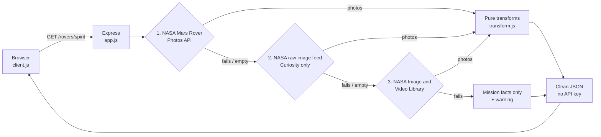

# Mars Rover Dashboard

Udacity *Functional Programming with JavaScript* project. A Node/Express server sits between the browser and NASA's APIs, and an ImmutableJS-powered frontend, built entirely from pure functions, lets you switch between **Curiosity**, **Opportunity** and **Spirit**. For each rover you see its mission facts and most recent photos, with NASA's Astronomy Picture of the Day as the page background.

## Run it

```bash
yarn install
cp .env-sample .env        # then put your NASA key in .env:  API_KEY=xxxxxxxx
yarn start                 # http://localhost:3000
```

| Command | What it does |
|---|---|
| `yarn start` | Real app, real NASA calls (needs `.env`) |
| `yarn test` | 13 tests on the pure functions, the fallback chain and the routes (Node's built-in test runner, no extra packages) |
| `yarn preview:mock` | Offline preview on port 3001 with fixture data, no API key needed |

In the Udacity workspace: `cd starter && yarn install && yarn start`, then click **Preview**. All frontend requests use relative URLs (`/apod`, `/rovers/...`), so the same code works locally and in the workspace.

## Note: the Mars Rover Photos API was retired

NASA archived `api.nasa.gov/mars-photos` in October 2025, after this project was written, so it no longer returns photos. The server therefore uses an ordered **fallback chain**: it still tries the original API first, then falls back to other live NASA sources. The UI shows which source supplied the photos.



Rover facts (launch date, landing date, status and so on) live in `src/server/rovers.js`. If the legacy API ever answers again, its live values override them automatically.

## File structure

```
src/
├── server/
│   ├── index.js       entry: loads .env, wires real fetch, starts server
│   ├── app.js         Express routes (/apod, /rovers, /rovers/:name)
│   ├── nasa.js        URL builders + fallback chain (fetch is injected)
│   ├── transform.js   pure functions that reshape NASA responses
│   ├── http.js        the only network edge (timeouts, error handling)
│   └── rovers.js      frozen rover mission facts
└── public/
    ├── index.html     ImmutableJS loaded from CDN (local fallback)
    ├── client.js      Immutable store, HOFs, pure components
    └── assets/stylesheets/  resets.css + mobile-first index.css
test/                  unit + route tests, fixtures, mock preview server
```

## Rubric map

| Rubric criterion | Where it's met |
|---|---|
| **Node/Express backend** with Express, body-parser, dotenv, ImmutableJS | `package.json`; `src/server/app.js` (body-parser middleware) |
| **JavaScript frontend** file structure | `src/public/` |
| **ImmutableJS via CDN script** | `src/public/index.html` |
| **API credentials** in `.env`, `.env-sample` holds no personal info | `src/server/index.js` → `resolveApiKey`; the key is only used server-side, and a test asserts it never reaches the browser |
| **Launch date, landing date, status, latest photos, date of latest photos** for all 3 rovers | `client.js` → `roverFactRows` (L176), `StatusBadge` (L164), `Gallery` (L226) |
| **Express as middleman** using functional methods | `app.js` routes (L27, L43) → `nasa.js` `fetchRoverPhotos` (L69) → `transform.js` |
| **Pure functions organize all logic** | Every component in `client.js` is `(data) → HTML string`; side effects are isolated in the "EDGE" section (render, updateStore, fetch, events). Backend logic is all in `transform.js` |
| **const / let / var used correctly** | `const` everywhere; one `let` for the store reference (`client.js` L16), which is swapped for a new Immutable Map on each update; no `var` |
| **Custom pure function using `map`** | `RoverTabs` (L134), `Gallery` (L226), `listOf` (L63), `fromLegacyLatest` / `fromRawFeed` (server) |
| **Dynamic component** (behaves differently based on a value) | `StatusBadge` (active vs complete), `RoverDashboard` (loading / error / data), `ApodPanel` (image vs video), `Gallery` (photos vs "no photos") |
| **≥ 2 reusable higher-order UI functions** | `listOf` (L63) returns a list renderer; `section` (L68) returns a section renderer; `withFallback` (L77) wraps any component; also `RoverTab(selected)` and `PhotoCard(roverName)` |
| **Interactive UI to choose a rover** | Tab bar (`RoverTabs`) with one delegated click listener; each rover is fetched once, then cached in the Immutable store |
| **Mobile-first styling**, mobile first in the stylesheet | `index.css`: base rules = phones, then `min-width` 768px (tablet), 991px (desktop) and 1824px (large) |

### "Stand out" extras
- **reduce**: `countByCamera`, `latestDate`, `onlyLatestSol`, the fallback chain itself
- **sort / find / includes / filter**: `sortByDateDesc`, `normalizeLibraryItem`, `isKnownRover`, `mentionsRover`
- **APOD** used as the full-page background, plus its own panel
- CSS star field, asteroid streak and loading animation (respects `prefers-reduced-motion`)
- API key redacted from any logged URL; every NASA call has a timeout
- Rover data is cached in the Immutable store, so switching tabs doesn't refetch
