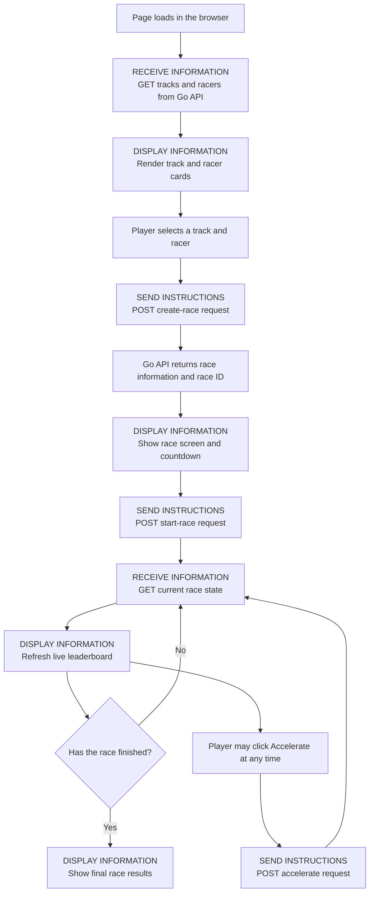

# UdaciRacer Sim — Project Breakdown

## The Three Fundamental Responsibilities

### 1. RECEIVE INFORMATION

**Fetch API · HTTP GET · Promises · async/await**

Retrieve information from the Go API, including available tracks, racers and the current state of a race.

### 2. SEND INSTRUCTIONS

**Fetch API · HTTP POST · JSON · async/await**

Send commands and the data required by the Go API to create a race, start it and accelerate the player's car.

### 3. DISPLAY INFORMATION

**DOM · Event listeners · Callbacks · HTML rendering**

Turn the information received from the API into visible browser content and respond to the player's interactions.

---

## The Three Responsibilities — How We Implement Them

| Responsibility | How we achieve it | Main JavaScript concepts — how they work in our project |
|---|---|---|
| **1. RECEIVE INFORMATION** | Request information from the Go API (port `3001`) using HTTP GET requests. | **1. `fetch()`** — Sends an HTTP GET request to the Go API to retrieve tracks, racers or current race information.  **2. Promises** — `fetch()` returns a Promise because the API response takes time to arrive. We use `.then()` to process the response when it becomes available and `.catch()` to handle rejected requests.  **3. `response.json()`** — Reads the response body and converts JSON into usable JavaScript objects and arrays. This is itself asynchronous and returns another Promise.  **4. `async/await`** — Allows our asynchronous functions to wait for retrieved information before proceeding with dependent operations. For example, we need the created race information before using its race ID in subsequent operations.  **5. Error handling** — Use `.catch()` or `try/catch` to handle failures during asynchronous operations. | 
| **2. SEND INSTRUCTIONS** | Send commands and necessary data to the Go API using HTTP POST requests. | **1. `fetch()`** — Sends POST requests to the Go API to perform operations such as creating a race, starting a race and accelerating a car. Unlike GET requests, POST requests can carry information in the request body.  **2. `JSON.stringify()`** — Converts a JavaScript object containing information such as `player_id` and `track_id` into JSON text so it can be transmitted to the API.  **3. Request configuration** — We use the `method: 'POST'` option, appropriate headers such as `Content-Type: application/json`, and a request body when required. Race creation requires a JSON body; starting and accelerating a race do not require a body according to the API specification.  **4. Promises** — The POST request also returns a Promise. We handle its completion or failure using Promise chaining or `async/await`.  **5. `async/await`** — Coordinates operations that must happen in sequence: create the race and obtain its ID → run the countdown → start the race → monitor its progress. The acceleration request is triggered separately when the player clicks the acceleration button.  **6. Error handling** — Handle failed requests so that unsuccessful commands do not silently disrupt the game. |
| **3. DISPLAY INFORMATION** | Convert the information received from the API into visible browser content and respond to player interactions. | **1. DOM manipulation** — Use the Document Object Model to access and modify HTML elements in the browser.  **2. Callbacks** — Pass functions to other functions so they can execute them when required. For example, `.map()` uses `renderRacerCard` as a callback to generate individual racer cards. Event listeners also execute callback functions when the player interacts with the interface.  **3. Array methods** — Use `.map()` to process racer and track arrays and generate HTML for each item; use `.join('')` to combine the generated HTML strings.  **4. Template literals** — Use backticks and `${}` to dynamically construct HTML using information received from the API.  **5. `innerHTML`** — Insert the generated HTML into the appropriate browser element using our `renderAt()` helper function.  **6. Event listeners and event delegation** — Use `addEventListener('click', ...)` to detect player interactions. Examine `event.target` to determine whether the player selected a track, selected a racer, started a race or clicked the acceleration button.  **7. Dynamic updates** — Use `setInterval()` to update the countdown every second and retrieve race information every 500 milliseconds. Refresh the leaderboard while the race is running and display the final results when the race finishes. |

---

## 4. Putting the Three Responsibilities Together

Now let's combine everything.

This is the actual communication cycle of our application.

### 1. RECEIVE INFORMATION

**Fetch API · GET · Promises · async/await**

Get tracks, racers and race positions from the Go API. The retrieved data becomes available to our JavaScript code.

### 2. SEND INSTRUCTIONS

**Fetch API · POST · JSON · async/await**

Create races, start races and accelerate cars. The frontend sends commands to the API; race creation also provides the race ID needed for the next steps.

### 3. DISPLAY INFORMATION

**DOM · Callbacks · Event listeners · HTML**

Show selection cards, the countdown, the live leaderboard and the final results.

The communication cycle repeats while the race is running. In particular, after a command is sent, the frontend retrieves the current race state with GET requests and displays the latest positions. The player can send an acceleration command while this monitoring continues.

### Application flow — from page load to race results

> **The central idea:** The Go API manages the race. Our JavaScript frontend receives information from it, sends it instructions and displays the resulting information to the player.
